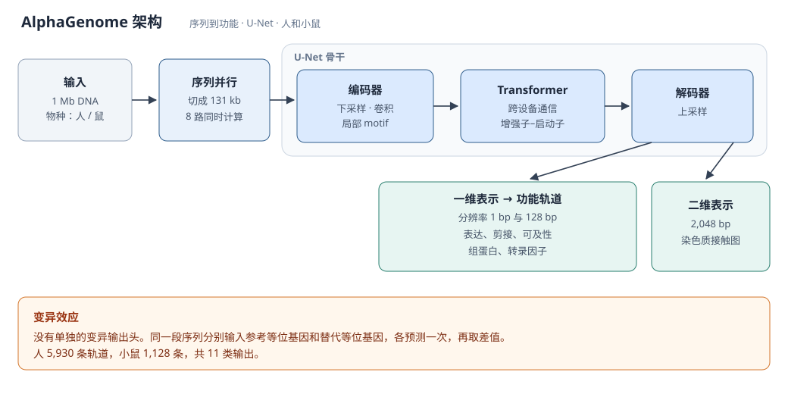
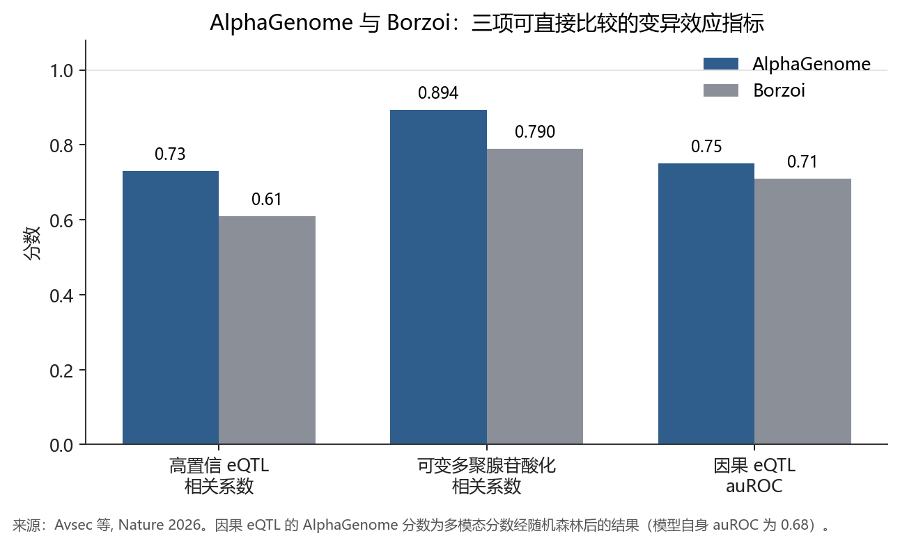
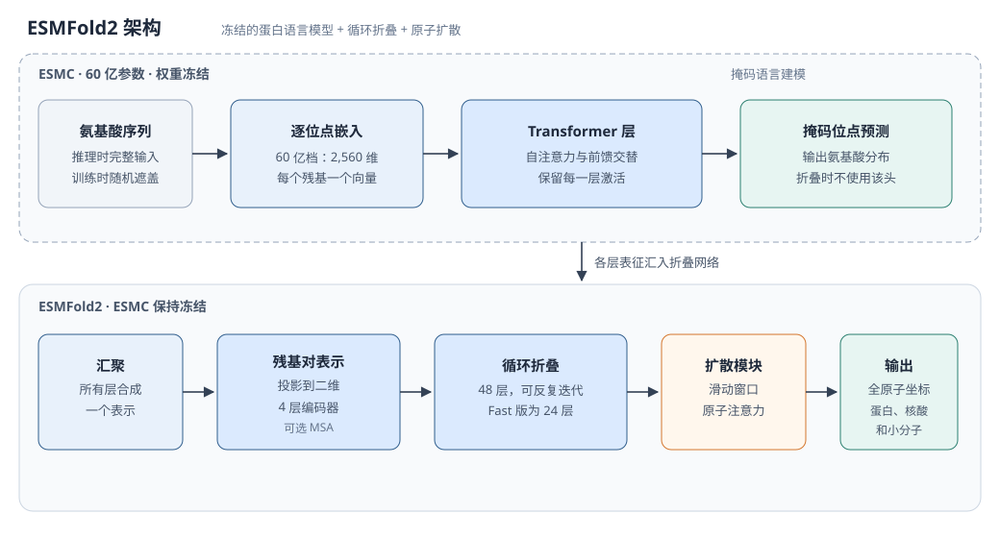
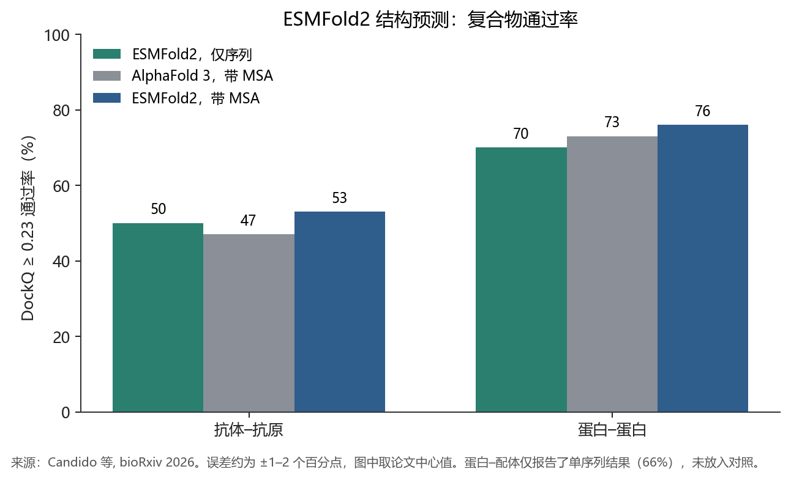
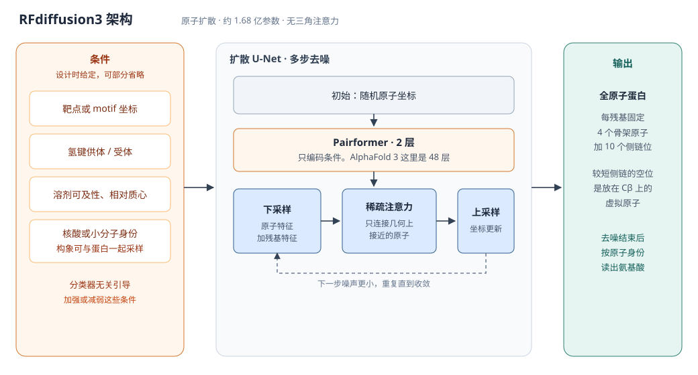
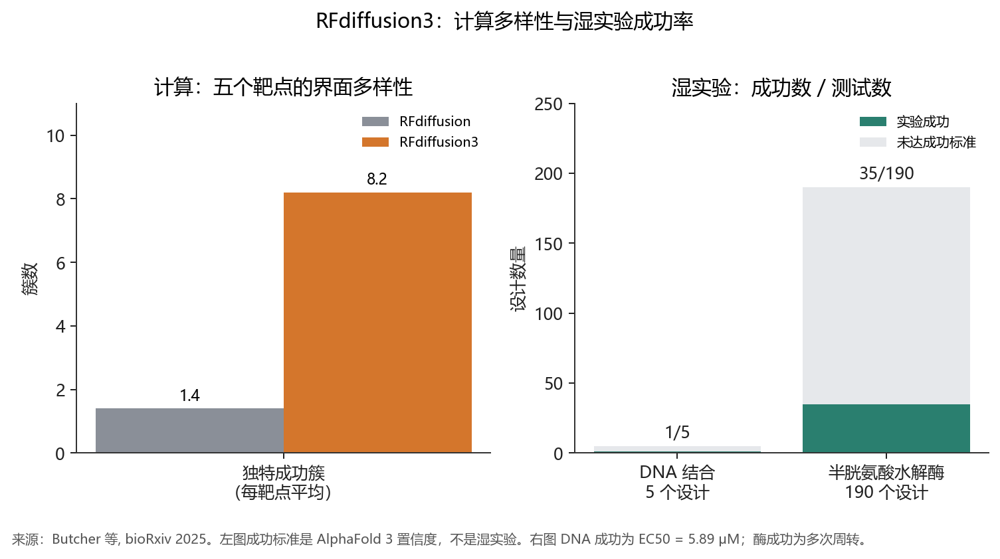
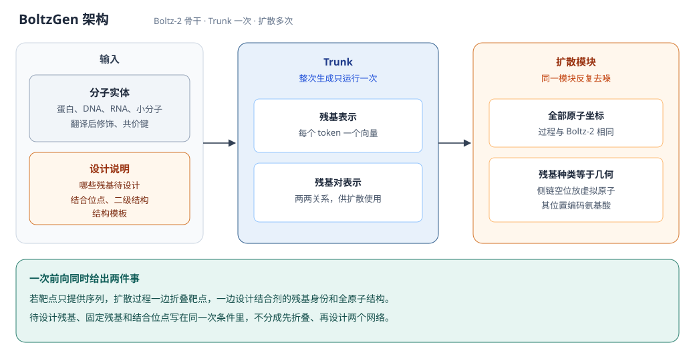
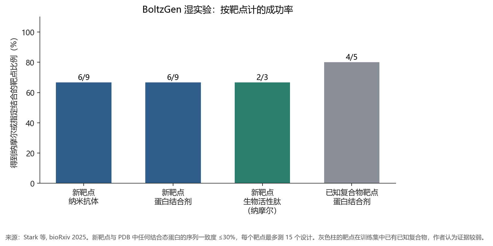
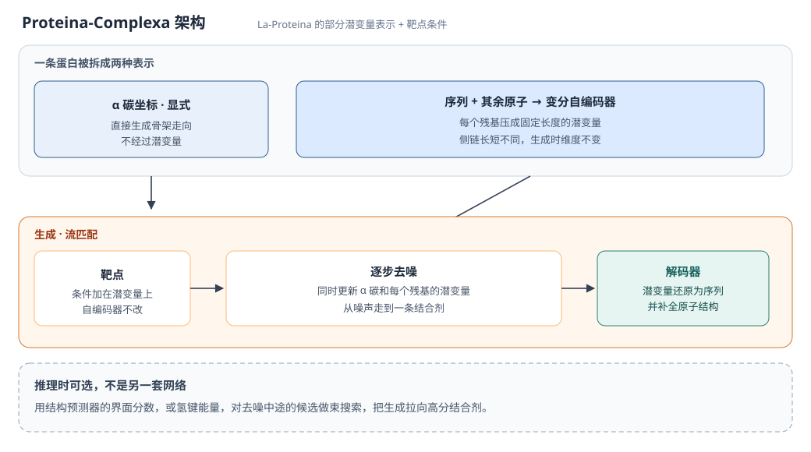
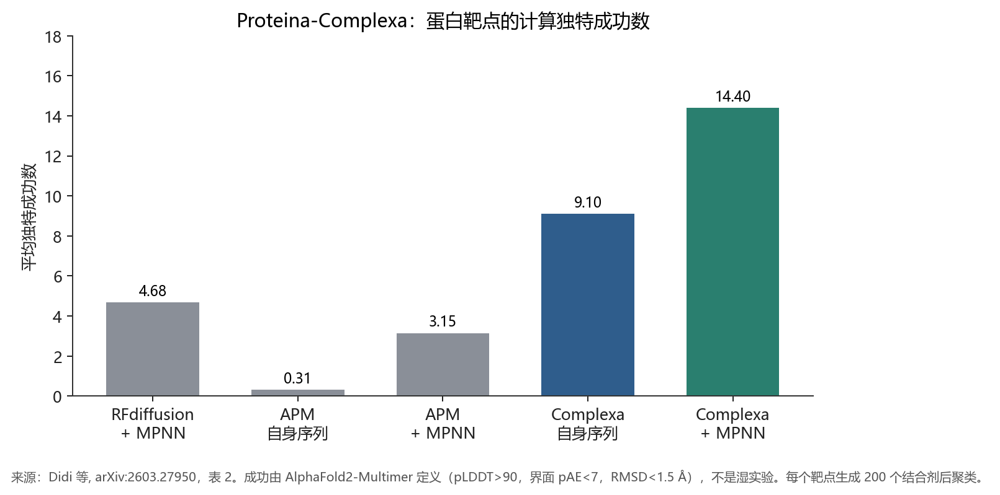

# 五个模型的架构、训练与数据

每个模型只保留三部分。图由论文中的数字重绘，不是原文插图。AlphaGenome 为 *Nature* 正式论文，其余四篇为预印本。

---

## 1. AlphaGenome（DeepMind）

Avsec 等，*Nature*，2026。https://doi.org/10.1038/s41586-025-10014-0

### 模型架构

输入 1 Mb DNA 和物种标记（人或小鼠）。骨干是 U-Net：编码器下采样，中间用 Transformer 跨设备传递长程信息，解码器上采样。卷积负责局部模式（剪接位点、转录因子足迹），Transformer 负责增强子–启动子这类长程依赖。

内部有两类表示。一维表示分辨率为 1 bp 和 128 bp，用于线性轨道；二维表示分辨率为 2,048 bp，用于染色质接触图。输出头按任务给出不同分辨率：RNA-seq、ATAC、DNase 为 1 bp，部分组蛋白和转录因子 ChIP 为 128 bp，接触图为 2,048 bp。人有 5,930 条轨道，小鼠有 1,128 条，共 11 类，覆盖表达、转录起始、剪接位点与剪接连接、可及性、组蛋白、转录因子结合和三维接触。1 Mb 被切成 131 kb 片段，在 8 块加速器上做序列并行。

变异效应不是单独的输出头，而是同一序列的参考等位基因与替代等位基因各预测一次，再取差。

### 训练方式

两阶段。预训练用实验测量值做监督，输入做位移和反向互补。基因组按四折交叉验证：折内模型只用四分之三区间训练，留出区间做测试；全折模型用全部参考基因组区间训练，作为教师。蒸馏阶段，一个学生模型学习复现多位全折教师在随机增强序列上的输出，以得到更稳的单一模型。

### 数据及其解读

训练标签来自人和小鼠细胞系、组织的功能基因组实验（RNA-seq、CAGE、PRO-cap、DNase、ATAC、ChIP-seq、Hi-C 等）。1 Mb 窗口盖住已验证增强子–基因对的 99%（465/471）。

未见过的基因组区间上，24 项轨道预测里 22 项超过当时最强外部模型；26 项变异效应评估里 25 项达到或超过最强外部模型。下图只保留能与 Borzoi 直接比的三项。

高置信 eQTL 的相关系数 0.73 对 0.61，可变多聚腺苷酸化 0.894 对 0.790，说明在强信号和剪接相关读出上优于上一代多模态模型。因果 eQTL 的差距小（0.75 对 0.71），而且 0.75 已经是多模态分数再经随机森林的结果，模型自己只有 0.68。全体精细定位 eQTL（17,675 个）的有符号 Spearman 相关只有 0.50，只看效应绝对值则降到 0.10。因此图中的优势集中在高置信子集，不能当成对任意变异效应量的预测。

---

## 2. ESMFold2（Biohub）

Candido、Hayes、Derry、Rao 等，bioRxiv 2026.06.03.729735。https://doi.org/10.64898/2026.06.03.729735

### 模型架构

两段。ESMC 是掩码语言模型：每个氨基酸映成向量（60 亿参数版为 2,560 维），经自注意力和前馈层，预测被遮住的氨基酸。发布的是 3 亿、6 亿和 60 亿三档；ESMFold2 使用冻结的 60 亿档。

ESMFold2 把 ESMC 各层表示汇成一个向量，投到二维残基对表示，经 4 层编码器，再由 48 层折叠模块循环更新（ESMFold2-Fast 为 24 层）。最后两层折叠状态送入带滑动窗口原子注意力的扩散 Transformer，去噪得到全原子坐标。可处理蛋白质、DNA、RNA、修饰氨基酸和小分子，MSA 可选。

### 训练方式

ESMC 用掩码语言建模，在约 28 亿条序列上训练：UniRef 2023_02 的 1.56 亿条、JGI 的 20.29 亿条、MGnify 2023_02 的 6.21 亿条。相对 ESM2 所用的约 5,000 万条 UniRef50，数据量扩大近两个数量级。60 亿模型训到计算最优附近，较小模型略超过该点。

ESMFold2 冻结 ESMC，在 PDB 与 AlphaFold 数据库结构上训练折叠头。开发实验里，语言模型训练计算量与折叠精度呈对数线性关系（单体 lDDT 的 *R*² = 0.92，蛋白–蛋白 DockQ 通过率的 *R*² = 0.93）。结构能力来自序列统计的缩放，不是单独写入的物理能量函数。

### 数据及其解读

下图是复合物预测的中心通过率（DockQ ≥ 0.23）。抗体–抗原来自 FoldBench；蛋白–蛋白的单序列 70% 来自 Runs N' Poses，带 MSA 的 76% 与 AlphaFold 3 的 73% 为论文直接对照。

仅用序列时，抗体–抗原 50% 已经高于带 MSA 的 AlphaFold 3（47%）。加上 MSA 后，两类任务都超过 AlphaFold 3。单序列蛋白–配体通过率为 66%，论文未给同设定的 AlphaFold 3 对照，故未画入。误差约 ±1 到 ±2 个百分点。

这证明 ESMC 表征里已经含有足够的相互作用信息，推理时不必再检索进化比对。它证明的是结构坐标预测，不是结合自由能或细胞功能。

---

## 3. RFdiffusion3（Baker 实验室）

Butcher、Krishna、Mitra 等，bioRxiv 2025.09.18.676967。https://doi.org/10.1101/2025.09.18.676967

### 模型架构

扩散的基本单元是原子，不是残基。每个残基固定为 4 个骨架原子加 10 个侧链原子（色氨酸的侧链重原子数）；较短侧链用放在 Cβ 上的虚拟原子补齐，去噪后再按原子身份读出氨基酸。

网络是 Transformer U-Net，约 1.68 亿可训练参数：下采样编码原子与残基特征，稀疏 Transformer 只让噪声坐标里彼此接近的原子和残基互相关注，上采样预测坐标更新。条件由仅 2 层的轻量 Pairformer 处理（AlphaFold 3 为 48 层），并去掉三角乘法和三角注意力。与 RFdiffusion、RFdiffusion2 不共享代码。典型长度上比 RFdiffusion2 大约快 10 倍。

条件可以是靶点坐标、功能 motif、氢键供体或受体、溶剂可及性和相对质心的位置。motif 坐标在去噪过程中保持给定，蛋白在该几何周围生成。使用分类器无关引导。

### 训练方式

数据为 PDB 中的蛋白–蛋白、蛋白–小分子、蛋白–DNA 复合物，功能 motif，以及一批 AlphaFold2 蒸馏结构。训练时把天然结构加噪到不同幅度，在随机保留的一部分条件（氢键、结合伙伴、motif）下，预测骨架和侧链原子坐标。氢键供体/受体标签只在一小部分样本中给出，以免模型离不开该条件。

### 数据及其解读

左图：五个靶点（PD-L1、胰岛素受体、IL-7Rα、Tie2、IL-2Rα）各 400 个骨架。按 AlphaFold 3 标准（链间最小 pAE ≤ 1.5，结合蛋白 pTM ≥ 0.8，RMSD < 2.5 Å）并按 TM-score 0.6 聚类后，平均成功簇 8.2 对 RFdiffusion 的 1.4。不聚类时，五个靶点里四个超过 RFdiffusion。原子 motif 酶基准 41 例中 37 例超过 RFdiffusion2。这些数字说明生成结构更多样，且更符合 AlphaFold 3 的置信度，评委仍是另一个模型。

右图才是实验。DNA 结合测试 5 个设计，1 个结合，EC50 = 5.89 ± 2.15 μM。半胱氨酸水解酶测试 190 个，35 个多次周转，最高 *k*cat/*K*m = 3557。催化所用的 Cys-His-Asp 几何来自天然酶 Ulp1，由人指定。计算通过率明显高于湿实验成功率。

---

## 4. BoltzGen（MIT）

Stark、Faltings、Choi 等，bioRxiv 2025.11.20.689494。https://doi.org/10.1101/2025.11.20.689494

### 模型架构

沿用 Boltz-2，分成 Trunk 和扩散模块。Trunk 只跑一次，产生残基和残基对表示；扩散模块多次去噪，输出全部原子坐标。设计中的氨基酸用几何表示：侧链上多出来的虚拟原子位置编码残基种类，因此序列和结构都在连续坐标空间里采样，扩散过程与 Boltz-2 相同。

输入可以是蛋白、DNA、RNA、小分子、翻译后修饰和共价键。把若干残基标成“待设计”后，模型同时给出这些残基的身份和全原子结构；若靶点只给序列，模型会一边折叠靶点、一边设计结合剂。设计说明语言还可固定残基类型、二级结构、结合位点和结构模板。

### 训练方式

扩散损失，数据是实验结构与自蒸馏结构的混合。样本随机裁剪后，再随机决定哪些链被设计、哪些亚结构或结合位点被固定。同一次训练因此同时监督折叠、结合剂设计和 motif 搭载，而不是为每一类任务单独建模型。

### 数据及其解读

有效性来自 8 组湿实验、26 个靶点，读出为表面等离子共振或生物层干涉的亲和力，部分还有细胞或抑菌功能。下图按靶点计成功率。

前三组是分布外或新模态。9 个新靶点在整个 PDB 中没有序列一致度高于 30% 的结合态蛋白，每个靶点最多测 15 个设计：纳米抗体和普通蛋白结合剂都是 9 个里 6 个达到纳摩尔。3 条生物活性肽各测 6 个设计，2 条达到纳摩尔。灰色柱是训练集里已经有已知复合物的靶点，20 个设计中 5 个靶点有 4 个得到结合剂；作者写明，这里的成功可能只是重组见过的界面，证据弱于新靶点。

新靶点上的 6/9 支持模型能外推到低同源表面，但每个靶点的实验样本量小，而且 9 个里仍有 3 个没有纳摩尔结合剂。

---

## 5. Proteina-Complexa（NVIDIA、Mila 等）

Didi、Zhang、Zhou 等，arXiv:2603.27950。https://arxiv.org/abs/2603.27950  
架构基础为 La-Proteina，Geffner 等，arXiv:2507.09466。

### 模型架构

La-Proteina 把蛋白拆成两部分：α 碳坐标显式生成；序列和其余原子放进每个残基固定长度的潜变量。先训练变分自编码器，再用流匹配同时生成 α 碳和潜变量，解码成序列和全原子结构。Complexa 不改这个自编码器，而是用潜变量上的靶点条件，把生成从单体扩展到“给定靶点、生成结合剂”。推理时可用界面置信度或氢键能量做 best-of-*N*、束搜索等，在生成过程中筛选。自身序列即可使用，不必先出骨架再交给 ProteinMPNN。

### 训练方式

分阶段。自编码器先在 AlphaFold 数据库单体上训练，再在 PDB 上微调，因为预测结构过于理想化。流匹配模型先在 Foldseek 聚类后的单体上预训练，再在结合剂–靶点对上训练。蛋白靶点用 Teddymer 加 PDB 多聚体。Teddymer 的做法是：按 TED 结构域注释把 AlphaFold 数据库中的多结构域单体切开，把空间上靠近的结构域对当成合成二聚体；界面 pLDDT > 70、界面 pAE < 10、界面长度 > 10 的聚类代表被留下。小分子靶点用 PLINDER，并以 LoRA 微调，避免在较小数据上过拟合。

### 数据及其解读

下图是不另做推理时搜索时，蛋白靶点上的平均独特成功数。每个方法、每个靶点生成 200 个长度 40–250 的结合剂，成功者再聚类。成功标准来自 AlphaFold2-Multimer：pLDDT > 90，界面 pAE < 7，结合剂 RMSD < 1.5 Å。

Complexa 自身序列的独特成功数 9.10，已经高于需要 ProteinMPNN 重设计的 RFdiffusion（4.68）和 APM（3.15）；再经 MPNN 为 14.4。小分子四个靶点（SAM、OQO、FAD、IAI）的独特成功数，RFdiffusion-AllAtom 为 2、3、5、8，Complexa 为 10、6、17、19。酶活性位点基准 41 项里 38 项超过 RFdiffusion2。

这些比较说明，在同一套折叠模型分数下，Complexa 生成的自洽结合剂更多、更快，而且不依赖外部序列设计。训练用的 Teddymer 来自 AlphaFold 预测结构，评分又用 AlphaFold2-Multimer，因此上升的是模型家族内部的一致性。论文没有给出与前几个模型同级的亲和力或细胞实验。
